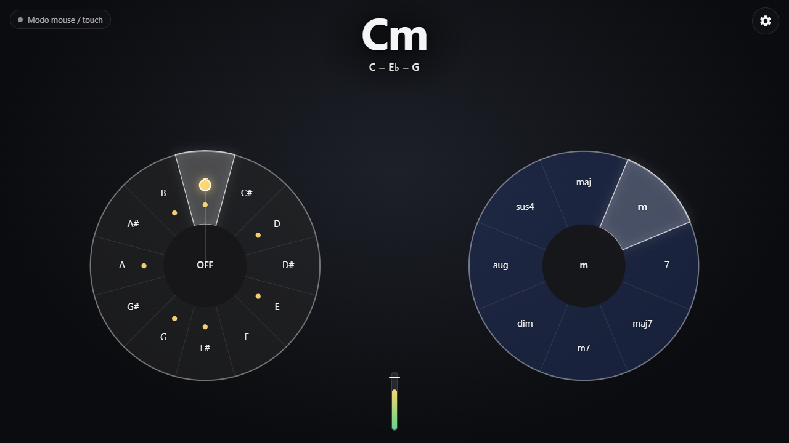

# Wheel Synth

Sintetizador de acordes que se toca con las manos frente a la webcam. Sobre el video hay dos ruedas:

- **Rueda izquierda (índice izquierdo):** elige la **nota raíz** entre las 12 notas cromáticas.
- **Rueda derecha (índice derecho):** elige la **calidad** del acorde: `maj`, `m`, `7`, `maj7`, `m7`, `dim`, `aug`, `sus4`.

Cada dedo índice funciona como un apuntador: el cursor sigue su punta.

La combinación suena en tiempo real como un pad sintetizado, con voice leading automático entre acordes. Todo corre en el navegador: el video nunca sale de tu equipo.



Está inspirado en el modo de ruedas de [GestureSynth](https://github.com/TChalla-102/GestureSynth), reescrito para la web con Vite, TypeScript, MediaPipe y Web Audio.

## Cómo correrlo

Requisitos: Node.js 20.19 o superior (o 22.12+) y Chrome o Edge de escritorio.

```bash
npm install
npm run dev
```

Abre la URL que muestra Vite (normalmente <http://localhost:5173>). Pulsa **Empezar** y acepta el permiso de cámara. El sonido y la cámara solo arrancan después de ese clic, por la política de autoplay de los navegadores.

Otros comandos:

| Comando | Qué hace |
| --- | --- |
| `npm run test` | Corre los tests de Vitest (teoría musical, ruedas, filtros, gestos, voces, ajustes). |
| `npm run build` | Verifica tipos y genera el sitio estático en `dist/`. |
| `npm run preview` | Sirve `dist/` localmente para probar el build. |

## Cómo se toca

El cursor de cada mano es la **punta del dedo índice**: apuntas y el punto lo sigue. MediaPipe detecta la mano completa para encontrar el dedo, pero solo la punta del índice controla las ruedas. En ajustes puedes volver a usar el centro de la palma.

| Gesto | Mano | Resultado |
| --- | --- | --- |
| Apuntar con el índice a un segmento de la rueda izquierda | Izquierda | Elige la raíz y suena el acorde. |
| Apuntar al círculo central **OFF** | Izquierda | Silencio, con release suave. |
| Recoger el índice (cerrar el puño) | Izquierda | Silencio; al volver a estirarlo, vuelve el volumen. |
| Abrir o cerrar toda la mano | Izquierda | Volumen, si en ajustes eliges «Volumen con: Apertura». |
| Juntar o separar pulgar e índice | Izquierda | Volumen, si en ajustes eliges «Volumen con: Pinza». |
| Sacar la mano del cuadro más de 150 ms | Izquierda | Release suave del acorde. |
| Apuntar con el índice a un segmento de la rueda derecha | Derecha | Elige la calidad del acorde. |
| Apuntar al centro de la rueda derecha, o sacar la mano | Derecha | Se mantiene la última calidad. |
| Salir un poco del borde de una rueda (hasta 1.6 × su radio) | Ambas | Sigue seleccionando por ángulo, más cómodo de tocar. |
| Alejarse más de la rueda | Ambas | Se mantiene lo último elegido. |

Para que el sonido no parpadee entre segmentos vecinos, la selección tiene **histéresis**. Para cambiar de segmento, la mano debe pasar al menos 4° más allá del borde y quedarse ahí 60 ms. Además, la posición de la mano se suaviza con un filtro One Euro.

### Dónde está cada cosa

En la rueda de raíces, **cada nota está en la hora del reloj que le corresponde**: C a las 12, C# a la 1, D a las 2… G a las 7 y B a las 11.

En la rueda de calidades, empezando arriba y en sentido horario: `maj` (12), `m` (1:30), `7` (3), `maj7` (4:30), `m7` (6), `dim` (7:30), `aug` (9) y `sus4` (10:30).

### Ejemplo: «Creep» (G → B → C → Cm)

1. Apunta con el **índice derecho** a `maj`, arriba en la rueda derecha.
2. Apunta con el **índice izquierdo** a **G**, a las 7 en la rueda izquierda. Suena **G** (G – B – D).
3. Sube el índice izquierdo hasta **B**, a las 11. Suena **B** (B – D♯ – F♯). El voice leading mueve G → F♯ y D → D♯, y B se queda quieta.
4. Avanza un segmento hasta **C**, a las 12. Suena **C** (C – E – G).
5. Sin mover el izquierdo, lleva el **índice derecho** de `maj` a `m`, a la 1:30. Suena **Cm** (C – E♭ – G): **solo cambia una nota**, E → E♭.
6. Repite desde el paso 2. Para cortar, recoge el índice izquierdo o apunta al centro **OFF**.

Con el mouse se toca igual. Mantén pulsado sobre G y arrastra a B y a C. Para pasar a Cm, suelta, haz clic en `m` y vuelve a pulsar C. En pantallas táctiles puedes usar las dos ruedas a la vez.

## Atajos de teclado

| Tecla | Acción |
| --- | --- |
| `Espacio` | Pánico: silencia todo de inmediato, incluidos los ecos. |
| `M` | Silenciar o activar el sonido. |
| `F` | Pantalla completa. |
| `[` y `]` | Preset anterior o siguiente. |
| `D` | Modo debug: 21 landmarks por mano, handedness, ángulo, segmento crudo frente al estable y medida → volumen. |
| `Esc` | Cerrar el panel de ajustes. |

## Modo sin cámara

En la pantalla inicial elige **Tocar sin cámara (mouse o touch)**. También se activa solo si no hay cámara o niegas el permiso.

- Pulsar o arrastrar sobre la rueda izquierda elige la raíz y suena mientras mantienes pulsado.
- Hacer clic en la rueda derecha elige la calidad.

Con cámara, el puntero también funciona y tiene prioridad sobre la mano mientras está pulsado.

## Ajustes

Están en el engranaje, arriba a la derecha, y se guardan en el navegador (`localStorage`).

| Ajuste | Opciones |
| --- | --- |
| Preset | Warm Pad, Bright Saw, Strings, Electric Piano (FM), Organ |
| Octava base | 2 a 5 (por defecto 4: el acorde gira alrededor de C4) |
| Reverb y delay | Mezcla de 0 a 100 % |
| Suavizado | De mínimo retraso a máximo suavizado del tracking |
| Punto de control | Punta del índice (por defecto) o centro de la palma |
| Volumen con | Dedo (índice estirado = suena, recogido = silencio; por defecto), apertura de la mano o pinza pulgar–índice |
| Asignar manos por | Auto (handedness con respaldo por posición), solo handedness o solo posición |
| Video en espejo | Activado por defecto, como un espejo real |
| Tamaño, separación y opacidad de las ruedas | Por defecto, radio del 26 % del alto, centros al 24 % del ancho a cada lado del centro de la pantalla y 55 % de opacidad |
| Resaltar escala | Marca con un punto las notas de una tonalidad (p. ej. G mayor). Es solo visual. |

### Calibración

Los umbrales de volumen están en `HANDS`, en `src/config.ts`. Con `D` puedes ver la medida cruda. En las pruebas con fotos reales, el índice estirado dio alrededor de 1.1 y recogido en un puño alrededor de 0.4. Si el volumen no llega a cero o a máximo, ajusta `indexExtension.curled` y `indexExtension.extended` (o `openness` y `pinch` para los otros modos).

La lista de calidades de la rueda derecha es el array `WHEEL_QUALITIES` del mismo archivo. Se puede reordenar o ampliar con cualquier calidad definida en `QUALITY_DEFS` (`src/music/theory.ts`): `sus2`, `6`, `m6`, `dim7`, `m7b5` o `add9`.

## Desplegar

`npm run build` genera un sitio estático en `dist/`. Usa rutas relativas, así que funciona tanto en la raíz de un dominio como en un subdirectorio. La cámara exige HTTPS; en `localhost` funciona sin él.

### Vercel

1. Importa el repositorio en <https://vercel.com/new>.
2. Vercel detecta Vite solo: comando `npm run build`, carpeta de salida `dist`.
3. Despliega.

Desde la terminal también funciona: `npx vercel`.

### GitHub Pages

El repositorio incluye `.github/workflows/deploy.yml`. En cada push a `main` corre los tests, compila y publica.

1. Sube el repositorio a GitHub.
2. En **Settings → Pages**, elige **Source: GitHub Actions**.
3. Haz push a `main`. El sitio queda en `https://<usuario>.github.io/<repositorio>/`.

### Cualquier hosting estático

Sube el contenido de `dist/` (Netlify, Cloudflare Pages, S3…).

## Cómo está hecho

```
src/
  main.ts              arranque, pantalla «Empezar», bucles de detección y render
  config.ts            notas, calidades de la rueda, geometría, umbrales y colores
  music/theory.ts      intervalos, nombres, ortografía, escalas y voice leading (puro)
  input/wheel.ts       geometría de ruedas, ángulo → segmento e histéresis (puro)
  input/controller.ts  manos → raíz, calidad y volumen; OFF, ausencia y pánico (puro)
  input/gestures.ts    extensión del índice, centro de palma, apertura y pinza (puro)
  input/coords.ts      landmark → píxel de pantalla con espejo y recorte (puro)
  input/assign.ts      qué mano controla cada rueda (puro)
  input/pointer.ts     modo mouse / touch
  tracking/filters.ts  filtro One Euro (puro)
  tracking/hands.ts    wrapper de MediaPipe HandLandmarker
  audio/allocate.ts    reparto de notas entre voces al cambiar de acorde (puro)
  audio/engine.ts      bus, delay, reverb, limitador, volumen, mute y pánico
  audio/voice.ts       voz: osciladores desafinados, filtro y ADSR
  audio/presets.ts     los 5 presets
  audio/impulse.ts     impulso de reverb generado por código
  ui/render.ts         dibujo de ruedas, cursores y debug en canvas
  ui/hud.ts            acorde, estado, medidor y avisos
  ui/settings.ts       modelo de ajustes, persistencia y panel
tests/                 Vitest
```

Decisiones principales:

- **Voice leading.** Para cada acorde se prueban todas las inversiones en posición cerrada, dentro de un rango alrededor de la octava base. Se elige la que menos se mueve respecto al acorde anterior, con una leve atracción al registro central para que no se desplace en progresiones largas. El bajo es la raíz una octava por debajo.
- **Ortografía.** Cada nota recibe la letra de su grado: la tercera de C es E, así que Cm se escribe C – E♭ – G y no C – D♯ – G. En teclas negras, el título usa la grafía más legible: A♯ mayor se escribe B♭ (B♭ – D – F) en lugar de A♯ – C𝄪 – E♯. Si las dos grafías empatan, gana el sostenido de la rueda.
- **Audio sin clics.** Las voces se crean una vez por preset y sus osciladores no se detienen nunca. Al cambiar de acorde:
  - las notas comunes no se re-atacan;
  - las que se mueven hasta una tercera mayor hacen glide de unos 40 ms;
  - los saltos mayores hacen crossfade con una voz libre.

  Todas las envolventes usan `setTargetAtTime` desde el valor actual.
- **Handedness.** MediaPipe etiqueta las manos suponiendo una imagen en espejo, y aquí recibe el cuadro crudo. Por eso la mano izquierda real llega como «Right». El modo auto corrige eso y, si dos manos tienen la misma etiqueta o la etiqueta contradice la posición en pantalla, asigna por posición.
- **Rendimiento.** Hay una detección por cuadro de cámara (`requestVideoFrameCallback`, con timestamps monotónicos) y el render va a 60 fps. MediaPipe se carga de forma diferida desde su CDN oficial. Usa la GPU si está disponible y, si no, la CPU.

## Privacidad

El video se procesa localmente con MediaPipe (WebAssembly) y no se envía a ningún servidor. Solo se descargan el runtime de MediaPipe (jsDelivr) y el modelo de manos (Google Cloud Storage). Por eso el modo cámara necesita conexión la primera vez.

## Compatibilidad

Pensado para Chrome y Edge de escritorio. En móviles carga y funciona el modo touch, con las dos ruedas a la vez. El modo cámara en móvil depende de la potencia del equipo.
